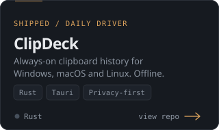
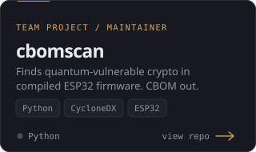
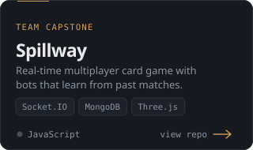
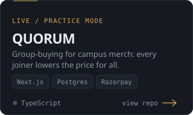
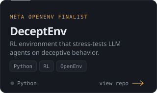
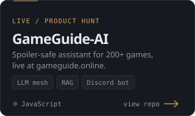

  

  <a href="https://tanmay-angarkar.vercel.app/">portfolio</a> &nbsp;/&nbsp;
  <a href="https://www.linkedin.com/in/tanmay-angarkar/">linkedin</a> &nbsp;/&nbsp;
  <a href="https://huggingface.co/Tanmay7697">hugging face</a>

CS undergrad at RV College of Engineering, Bengaluru (class of 2029). I build LLM applications and the tooling around them: agents, RAG, evals and RL environments. Meta PyTorch OpenEnv finalist, Google Student Ambassador.

### Selected work

<table>
  <tr>
    <td width="33%"></td>
    <td width="33%"></td>
    <td width="33%"></td>
  </tr>
  <tr>
    <td width="33%"></td>
    <td width="33%"></td>
    <td width="33%"></td>
  </tr>
</table>

### Activity

The cards, contribution snake and language bar are hand-built SVGs, regenerated daily by a GitHub Action from <code>projects.json</code> and the GitHub API. No third-party widgets.
